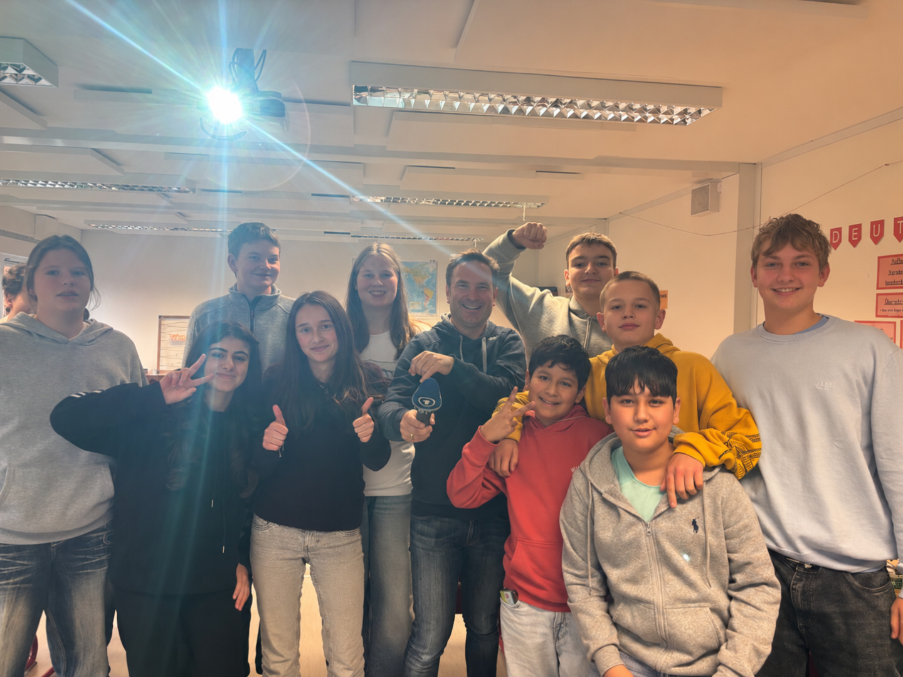
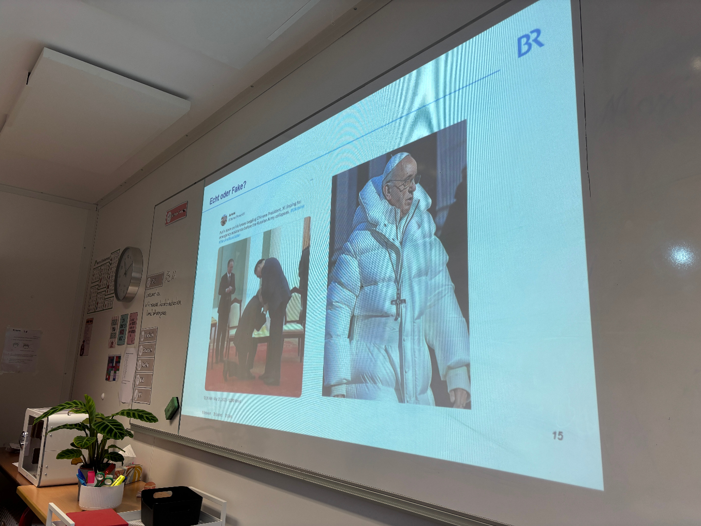

+++
title = "ARD-Jugendmedientag: Von Fake News bis Live on Air – die 8G mittendrin!"
date = 2026-11-17
description = "Die Klasse 8G beschäftigte sich beim ARD-Jugendmedientag mit Fake News und KI und nahm einen Radiobeitrag auf, der live auf Bayern 1 lief."

[taxonomies]
tags = ["Aktuelles", "Schulleben", "Mittelschulaktivitäten", "Bildung", "Medienkompetenz", "KI", "Fake News", "Kooperation", "ARD-Jugendmedientag"]
+++

Wie erkennt man Fake News? Welche Chancen und Gefahren birgt Künstliche Intelligenz? Mit diesen Fragen beschäftigte sich die Klasse 8G am Donnerstag, den 12. November, beim deutschlandweiten ARD-Jugendmedientag.

<!-- more -->

Einen besonderen Einblick in die Medienwelt ermöglichte Martin Breitkopf, BR-Korrespondent, der unsere Schule besuchte. Gemeinsam mit den Schülerinnen und Schülern sprach er darüber, wie man Falschmeldungen erkennt, Informationen kritisch hinterfragt und KI-generierte Inhalte entlarvt.

Anschließend wurde die Klasse selbst aktiv: Sie analysierte Videos und untersuchte, ob diese mithilfe von Künstlicher Intelligenz verändert oder künstlich erzeugt worden waren.

Das absolute Highlight folgte zum Schluss: Die Klasse durfte einen eigenen kleinen Radiobeitrag aufnehmen, der anschließend live auf Bayern 1 ausgestrahlt wurde!

Ein spannender und lehrreicher Tag mit vielen neuen Erkenntnissen und einer ganz besonderen Radioerfahrung. Ein herzliches Dankeschön an Martin Breitkopf für den Besuch und die interessanten Einblicke!

<!-- TODO: Audio des Radiobeitrags einbinden, sobald die Erlaubnis des BR vorliegt -->
